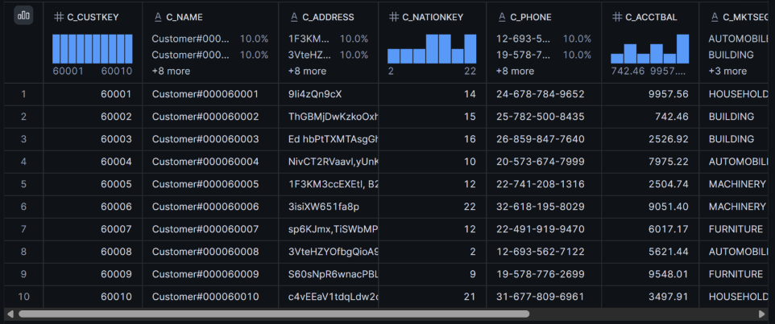
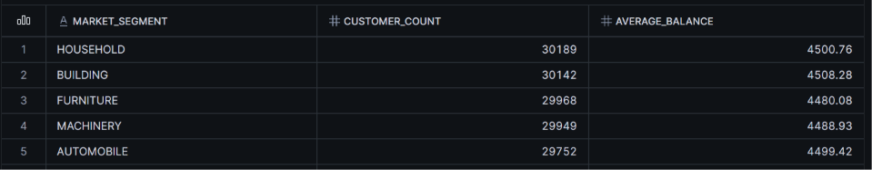
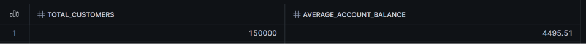

# HackAutumn

#Problem statement :

The challenge: Organizations hold large amounts of information in databases, spreadsheets, documents and other sources. Getting a useful answer often takes technical skills, specialised queries or hours of manual searching, so the people who understand the questions best are often the least able to reach the data.

Our mission: Create an AI-powered data experience that lets people ask questions in everyday language and get useful answers grounded in the available data, with enough explanation that users trust the response reflects the information actually examined. 

# DataMind - Talk to Your Data

## Project Overview
DataMind is an AI-powered open-source data agent that lets users ask questions in natural language and receive grounded answers calculated directly from Snowflake sample datasets using Google Gemma.

## Features
- **Natural Language Querying:** Ask questions in plain English.
- **Deterministic Computation:** Answers are computed in real time using SQL executed against Snowflake.
- **Traceable Evidence:** Displays the exact SQL executed and raw result rows returned by Snowflake.
- **Read-Only Safeguards:** Blocks non-SELECT queries to prevent unauthorized database modifications.

## Architecture & Workflow
1. User enters a question in the Streamlit UI.
2. Google Gemma converts the user's question into a Snowflake SQL query based on database schema.
3. The SQL statement is validated by a read-only safeguard layer.
4. The validated query is executed on Snowflake (`SNOWFLAKE_SAMPLE_DATA`).
5. Results, raw data rows, and an explanation are displayed to the user.

## Setup and Installation

### Prerequisites
- Python 3.9+
- A Snowflake account with access to `SNOWFLAKE_SAMPLE_DATA`
- Google Gemma API key (Google AI Studio / Hugging Face)

### Local Deployment
1. Clone the repository:
   ```bash
   git clone [https://github.com/ubrahmmani/datamind.git](https://github.com/ubrahmmani/datamind.git)
   cd datamind

## SQL Exploration — Customer Data Analysis

As part of the PS1 (DataMind: Talk to Your Data) checkpoint, we explored SQL queries for customer data analysis using Snowflake.

The following screenshots show the outputs obtained by executing our SQL queries.

### 1. Customer Preview

Displays a preview of the customer data used for analysis.



### 2. Market Segment Analysis

Shows the output of the query used to analyze customer market segments.



### 3. Overall Aggregation

Shows the results of the overall aggregation query.


 
